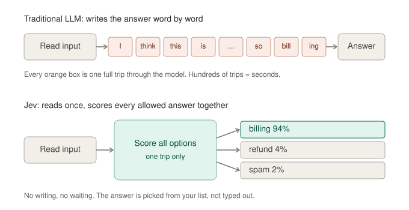
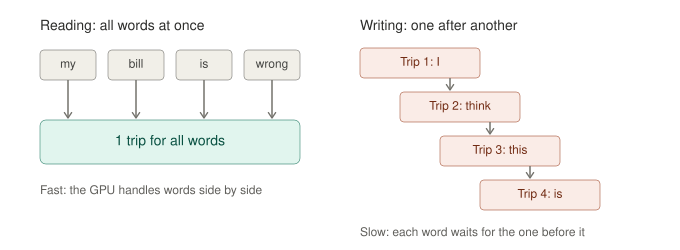
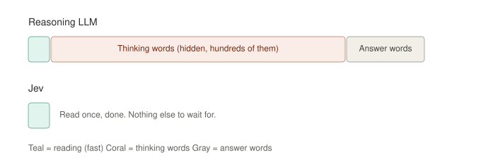
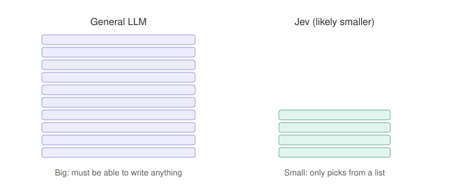
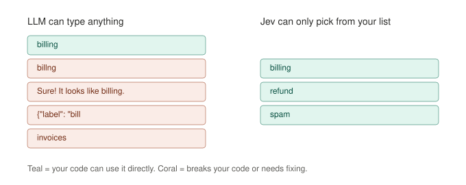
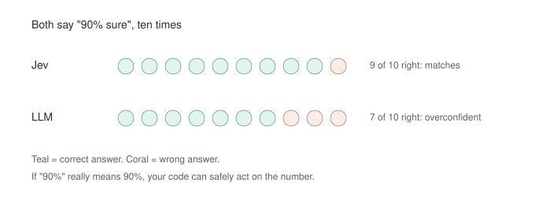
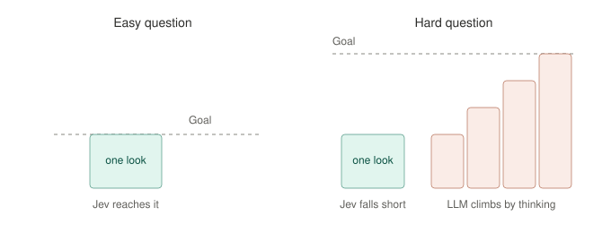
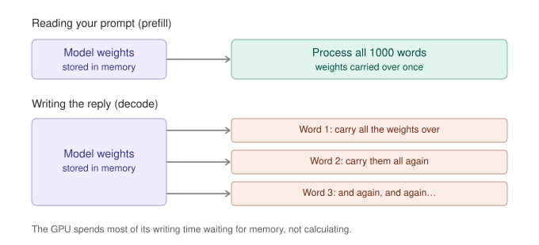
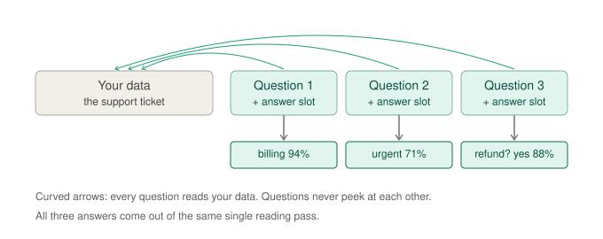
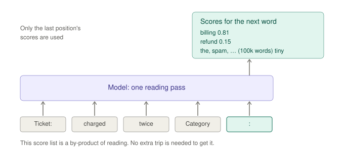

# Jev (TypeSafe AI): Why a "Decision Model" Is So Much Faster Than an LLM
> **Session Date:** 2026-09-30  
> **Duration context:** Deep-dive (technical first pass, then several simplification passes, ending in GPU memory mechanics)  
> **Tags:** `#jev` `#typesafe-ai` `#decision-models` `#llm-inference` `#prefill` `#decode` `#memory-bandwidth` `#calibration` `#rlcd` `#structured-outputs`

## Overview
Jev is TypeSafe AI's "System One" model, launched in early access on Sept 15, 2026. It takes unstructured state plus typed questions and returns choices, scores, and yes/no answers with calibrated probabilities, in roughly 70–500 ms. It never generates text. This session unpacked *why* it's so fast (it removes the decode loop entirely), how "reading the answer out of the prefill pass" works, why its outputs are always well-typed and its confidences trustworthy, and what it gives up. It ended with the root cause of slow LLM generation: every generated token must stream all model weights from HBM through the compute cores.

**Teaching arc:** full technical explanation → user asked to slow down → plain-language analogy + visuals → re-explanation of the six technical points in plain language → "but doesn't it still have to write the answer?" → "the first word comes for free" explained with an example → confirming the memory-bandwidth root cause.

> Note: TypeSafe has disclosed only three things about internals: a new architecture, a parallel sampler, and a post-training method called RLCD. Everything about *how* it's implemented below is inferred from its behavior and from open reproductions (SemIf, Laya), and is marked as such.

---

## Core Concepts

### 1. The one-line mental model
- **LLM** = read once (prefill), then a long loop of "fetch all the weights, write one token".
- **Jev** = read once, then look at the answer slots and pick.

**LLM = writer. Jev = judge.** Everything else (speed, free outputs, guaranteed types, calibration) follows from removing the decode loop.

Analogies used:
- **Exam:** the LLM writes an essay answer word by word; Jev fills in a multiple-choice bubble.
- **Restaurant menu:** the LLM waiter writes out a sentence describing your dish; with Jev you point at item #1 on a menu that was already printed.

### 2. Where time goes in an LLM call: prefill vs decode
- **Prefill (reading the prompt):** all N prompt tokens go through the model in **one** forward pass. Weights are loaded from HBM once and applied to all N tokens, giving an arithmetic intensity of about N FLOPs/byte, so it's **compute-bound** and uses the tensor cores well.
- **Decode (writing the reply):** **one token per forward pass**. Each step must stream all weights (plus the growing KV cache) from HBM but does only about 2P FLOPs per sequence. Intensity is about 1 FLOP/byte, versus the ~300 FLOP/byte an H100 needs to be compute-bound. So decode is **memory-bandwidth-bound**, at roughly 10–30 ms per token for large models.
- **Key consequence:** prefilling a whole 2k-token prompt costs about the same wall time as generating 2–3 output tokens.
- This is also why output tokens cost more than input tokens. TypeSafe's comparison table cites LLM output at ~5x input price; Jev's outputs are free.

**Chef analogy:** the recipe book (the weights) is huge and on a far shelf. To cook 1,000 dishes at once, fetch it once. To write a reply, fetch the whole book again **for every word**. The trip to the shelf is the slow part.

### 3. Why weights must be re-streamed for every token (user's closing question)
User: *"the reason why llm needs to load all weights all the time is because forward pass needs all weights for all our layers right? … And those weights needs to be loaded from VRAM to GPU everytime right?"*

**Yes, with one correction.** VRAM (HBM) *is* the GPU's memory. The weights move from HBM to the **compute cores' on-chip memory** (SRAM/cache):

| | VRAM (HBM) | On-chip memory (cache/SRAM) |
|---|---|---|
| Size on an H100 | 80 GB | ~50 MB |
| Speed | fast | much faster |
| Role | the warehouse | the workbench next to the cores |

Weights (GBs) can't stay on a workbench measured in MBs, so each forward pass streams them layer by layer: layer 1 in, used, evicted, then layer 2, and so on. The next token restarts from layer 1.

Worked numbers for an **8B model on one H100**:
- Moving the weights: 8B × 2 bytes = 16 GB ÷ ~3.35 TB/s ≈ **5 ms per token**
- Doing the math: ~16 GFLOP ÷ ~1,000 TFLOP/s ≈ **0.016 ms**
- So the cores finish ~300x faster than the weights arrive. The GPU is mostly **waiting on memory** ("memory-bound").

Extra details:
- **Batching:** one weight delivery serves many users' next tokens. It improves throughput and cost, but *your* reply still arrives one token per delivery.
- **KV cache:** each decode step also re-reads stored keys/values for all previous tokens. This adds memory traffic that grows with context length.
- **Link to Jev:** Jev only ever pays for the "one delivery, many tokens" prefill mode, which is the hardware's efficient mode.

### 4. Jev's core trick: read the answer out of the prefill pass
If every output comes from a finite, pre-declared set, decoding isn't needed. You only need logits at the right positions, restricted to the right options.

- **Answer slots:** each question gets a designated position. After the single forward pass, the hidden state at that slot is turned into a score per allowed option.
- **Question packing with an attention mask ("no peeking"):** each question block attends to the shared state and to itself, but not to sibling questions. The state's KV is computed once and shared (prefix sharing), and questions can't contaminate each other. This is similar to tree attention in speculative decoding and to packed multiple-choice scoring.
- **Option scoring:** either options in-context with a score read per option position (zero-shot, arbitrary labels), or a head over a fixed output-slot space. Jev caps cardinality at **255** and uses a two-stage "score independently, then choose" approach for larger sets. *Inference, not disclosed:* the 255 cap hints at a fixed-width slot space (8 bits, one reserved).
- **Backbone:** decoder-style with readout slots, or bidirectional encoder-style (strictly more expressive for pure scoring). Open reproductions use both: **SemIf** reads option probabilities from a frozen Qwen3.5-4B with no training; **Laya** uses a 421M ModernBERT-large backbone (~33–40 ms/question on a T4).

### 5. "Doesn't Jev still have to write the answer?" (user question)
User: *"and you said, jev doesn't have to write. Why so, it still need to write answer right?"*

It gives an answer but **picks** it rather than **writing** it.
- **Writing** = creating the answer token by token. An LLM answering `billing` in JSON might emit `{`, `"label"`, `:`, `"`, `bill`, `ing`, `"`, `}`, which is 8 trips for one tiny answer.
- **Picking** = the text already exists in *your* option list. Jev outputs only **numbers** (one score per option); ordinary code takes the argmax (microseconds) and copies the label from your list. The model effectively says "option #1" and the system looks up its name.

### 6. The "free first word": next-token scores are a by-product of prefill
User: *"Again please elaborate in detail with example: Even a normal LLM, at the very end of its reading phase, already has a 'gut feeling' score for what its first word should be."*

- LLMs are trained only to predict the next token, so the final layer (unembedding) always turns the **last position's** hidden state into a score for every vocabulary token (~100k+).
- That distribution is produced *by* the prefill pass itself, so the first output token's probabilities cost **no extra trip**.
- The expensive part is everything after: token 2, token 3, JSON brackets, reasoning tokens.
- **Jev's idea in one line:** an LLM already knows its answer after reading; Jev stops there and takes it instead of spending more trips typing it out.

Two catches and how Jev handles them:
1. **One "next token" per pass:** free scores appear only at the end of the input, so you'd get one question per trip. Solution: an answer slot after *each* question, with question blocks masked from each other.
2. **Options sharing a first token** (e.g. "billing issue" vs "billing dispute"): the first-token score can't separate them. Jev scores whole options via its own answer slots; the exact method isn't public.

### 7. "Can't hallucinate" means the support equals the schema
Logits are computed only for the schema's options, so out-of-schema outputs have **exactly zero** probability. No misspellings, no chatty prefixes, no broken JSON.
- Compare with **constrained decoding** on an LLM: masking also guarantees syntax, but you still pay decode costs and the model can spend steps inside valid string fields.
- **Caveats:** it can still pick the *wrong* option, and text planted in the input can steer the verdict (Pydantic docs), so prompt injection still applies.

### 8. RLCD and calibration: proper scoring rules vs RLHF
- **Pretraining** uses cross-entropy (log loss), a **proper scoring rule**: it's minimized only by reporting true probabilities. So base models are reasonably calibrated.
- **RLHF/RLVR** optimizes a scalar reward under a reverse-KL penalty, which is **mode-seeking**: it pushes mass onto the preferred answer. This causes the known post-training calibration degradation. Verbalized "confidence: 0.9" is just more generated text, not tied to accuracy.
- **RLCD** presumably rewards the probability vector with a proper scoring rule (log score/Brier), so that p = 0.94 is right about 94% of the time.
- **Why it matters:** a trustworthy probability can be a threshold in code ("auto-approve > 0.9, else escalate"). It tells you *which* 5% to hand to a human.

Plain-language analogy:
- **Jev is graded like a weather forecaster:** say 70% rain, and you're scored on whether it rains ~70% of those times. Honesty is the only way to win.
- **A chat LLM is graded like a talk-show guest:** rewarded for answers people like, and confident answers get liked, so it learns to sound surer than it is.

### 9. Where the "194x faster / 445x cheaper" comes from

| Gain | Roughly how much |
|---|---|
| Not decoding the answer | ~**5x**. SemIf, same frozen model: ~1 s for 21 questions via logit readout vs >5 s via generated JSON; agreed on 18/21 |
| Not generating reasoning tokens | The **biggest** share; comparisons are against reasoning-mode frontier models |
| Probably a much smaller model | Smaller P shrinks prefill cost linearly (inferred from price/latency) |
| Serving economics | Prefill-only: no growing KV cache, no stragglers, fixed compute per request, large compute-bound batches |

TypeSafe itself says the 193.6x / 444.6x figures come from its own workflow evals and are likely at the **high end** of real-world gains. The fair comparison is against a **fine-tuned encoder / calibrated classifier**, not an LLM.

### 10. What Jev gives up
- **Fixed compute per decision ("System One"):** one forward pass of serial depth per answer. LLMs buy extra serial compute by emitting tokens (each written step is a stair to stand on); Jev can't.
- **Conditional independence between answers:** with masked question blocks, P(a₁, a₂ | s) = P(a₁|s)·P(a₂|s). Autoregressive JSON conditions answer 2 on answer 1. For coupled decisions, chain Jev calls in your own code.
- **No generation:** no summaries, emails, code, explanations, or free-form arguments. The REFLEX paper had to add a cheap generative executor between Jev and the strong LLM for this reason.
- **Other practical limits:** early access, text only, served from the US West Coast, 255-option cap per question.

---

## Worked Examples

### Readout sketch: many decisions from one forward pass
The core mechanism, written as pseudocode (inferred design, not TypeSafe's actual code):

```python
# state + all questions (with their option sets) packed into ONE sequence
h = transformer(tokens, attn_mask)          # single forward pass, prefill only

for q in questions:
    h_q = h[q.answer_slot]                  # hidden state at a designated position
    logits = h_q @ W_q.T                    # W_q = embeddings/heads for q's options ONLY
    probs  = softmax(logits)                # distribution over the schema, nothing else
```

`attn_mask` lets each question block see the shared state and itself, but not other questions. Because `W_q` contains only the allowed options, out-of-schema outputs are impossible by construction.

### Cost model: LLM vs Jev

```
LLM:  T ≈ T_prefill(N) + K · T_decode_step        (K = reasoning + JSON tokens, hundreds to thousands)
Jev:  T ≈ T_prefill(N + question tokens)          (K = 0)
```

### "The first word is free": a step-by-step example
Prompt:

```
Ticket: I was charged twice for my order.
Category (billing / refund / spam): 
```

After the single reading pass, the last position already holds next-token scores over the whole vocabulary (illustrative numbers): `billing 0.81`, `refund 0.15`, everything else tiny.

What a normal LLM then does, if `billing` tokenizes as `bill` + `ing` and JSON is requested:

| Trip | What happens | Token written |
|---|---|---|
| 1 (reading) | Reads prompt, scores first token | `{` |
| 2 | Streams all weights again | `"category"` |
| 3 | Streams all weights again | `:` |
| 4 | Streams all weights again | `"bill` |
| 5 | Streams all weights again | `ing"` |
| 6 | Streams all weights again | `}` |

The shortcut (what SemIf does, and the Jev idea): stop after trip 1 and keep only the option scores:

```
billing → 0.81
refund  → 0.15
spam    → 0.01
```

Renormalize over the three (≈ 0.84 / 0.16 / 0.01), take the argmax, and return `billing` from your own list. **One trip total, nothing written.**

Jev's actual output shape for a ticket-routing call:

```
billing → 0.94
refund  → 0.04
spam    → 0.02
```

### Memory-bound arithmetic (8B model, one H100)

```
Weight bytes per token : 8e9 params × 2 bytes = 16 GB
Time to stream weights : 16 GB / 3.35 TB/s ≈ 5 ms
FLOPs per token        : 2 × 8e9 = 16 GFLOP
Time to compute        : 16e9 / 1e15 FLOP/s ≈ 0.016 ms
Ratio                  : ~300x → decode is memory-bound
```

### Suggested hands-on experiment
Reproduce the SemIf-style readout: take a small Qwen model, pack a state plus a few questions with a block attention mask, read logits at the answer slots restricted to option tokens, and time it against JSON generation **on the same weights**. This isolates the pure "no decode" gain.

---

## Diagrams

### 1. Overview: LLM writes word by word, Jev scores all options in one trip


Each orange box is a full trip through the model; Jev does one trip and returns a probability per option.

### 2. Reading is parallel, writing is sequential


Prefill processes all prompt tokens side by side in one pass; decode needs a separate, dependent trip per token.

### 3. Where the time goes


Hidden thinking tokens dominate a reasoning LLM's latency; Jev only has the reading slice.

### 4. Model size (likely)


Jev's size is undisclosed; a narrower job plausibly allows a smaller model, making each trip cheaper.

### 5. Output format safety


Free text can be misspelled, chatty, or broken JSON; Jev can only return one of your listed options.

### 6. Calibration


Illustration of calibrated vs overconfident models; the exact 7/10 is illustrative.

### 7. One quick look vs step-by-step thinking


The thinking tokens that make LLMs slow are also what let them solve hard, multi-step problems.

### 8. Prefill vs decode: carrying the weights


The core hardware reason decode is slow: memory traffic, not math.

### 9. Question packing with answer slots


Each question reads the shared data but not other questions; all answer slots are filled in the same pass.

### 10. Next-word scores come free after reading


The distribution for the first output token is a by-product of the prefill pass.

---

## Comparisons & Tradeoffs

| Aspect | Existing LLMs | Jev (System One) |
|---|---|---|
| Training objective | RLHF (human preference) / RLVR (verifiable rewards) | RLCD (calibrated decisions) |
| Inputs | Unstructured text, emphasis on sequential messages | Unstructured text, emphasis on structured program state |
| Outputs | Strings; must be parsed/validated; can drift | Typed values from a predeclared schema; no type errors |
| Sampling | Sequential, one token at a time | Parallel, all outputs in one pass |
| Latency | Seconds (3–329 s cited for frontier models) | 70–500 ms end to end |
| Pricing | Input $0.20–$10/MTok; output ~5x input | Input $0.042/MTok; output free |
| Confidence | Verbalized, often overconfident | Calibrated probabilities on every output |
| Reasoning | Can think step by step | One forward pass per decision |
| Answer dependencies | Later fields conditioned on earlier ones | Answers independent within a call |
| Best for | Writing, open-ended reasoning, agents, code | Routing, classification, scoring, guardrails, smart if-statements |

| Hardware phase | Prefill (reading) | Decode (writing) |
|---|---|---|
| Tokens per forward pass | All N prompt tokens | 1 |
| Weight loads | Once for all tokens | Once per token |
| Arithmetic intensity | ~N FLOPs/byte | ~1 FLOP/byte per sequence |
| Bottleneck | Compute | Memory bandwidth |

---

## Key Takeaways
- Jev is not a faster LLM; it removes the decode loop. Its answer is a **readout from the prefill pass**, not generated text.
- Decode is slow because each token must stream all weights from HBM through the cores (~5 ms/token for 8B on an H100, while the math takes ~0.016 ms).
- A 2k-token prefill costs about the same wall time as 2–3 decoded tokens, which is why output tokens are priced higher.
- The next-token distribution after prefill is **free**. Jev-style models exploit this by placing an answer slot after every question and masking questions from each other.
- The pure "no decoding" speedup is about **5x** (SemIf, same model). Most of the headline 194x comes from not generating reasoning tokens, plus a likely smaller model and prefill-only serving efficiency.
- "Can't hallucinate" = **the support of the output distribution equals the schema**. Wrong answers and prompt injection are still possible.
- Cross-entropy/log-loss is a proper scoring rule, which keeps base models calibrated; RLHF's mode-seeking objective makes them overconfident. RLCD makes calibration the primary objective, so probabilities can be used as thresholds in code.
- Tradeoffs: fixed compute per decision (no CoT), conditionally independent answers within one call, no text generation.
- Evaluate Jev against a fine-tuned encoder/calibrated classifier, not against an LLM.
- Heuristic: **use the judge (Jev) for bounded picks; escalate to the writer (LLM) when you need words or multi-step reasoning.**

## Open Questions / Next Steps
- Jev's actual architecture (encoder vs decoder backbone, answer-slot mechanism, why exactly 255 options) is undisclosed.
- How RLCD works concretely (which scoring rule, how rewards are built) isn't public.
- Whether Jev's pricing is sustainable remains to be seen (TypeSafe says so itself).
- Hands-on: build the SemIf-style logit readout with a small Qwen model and a block attention mask, and benchmark it against JSON generation on the same weights.
- Possible follow-ons: FrugalGPT/RouteLLM cascades, the REFLEX "Jev + strong LLM fallback" pattern for agents, and fine-tuning Laya for a task.
- Candidate for a Devocracy talk or the LLM inference internals notes: the prefill/decode asymmetry explains both LLM pricing and Jev's speed.

## References
- TypeSafe AI, "Introducing System One Models & Jev" (Sept 15, 2026): https://typesafe.ai/blog/introducing-system-one-models-and-jev
- TypeSafe docs: https://docs.typesafe.ai/ · Workflow evals: https://evals.typesafe.ai/
- VentureBeat, "Companies are paying LLMs to generate text for decisions that only need a label" (Sept 28, 2026): https://venturebeat.com/orchestration/companies-are-paying-llms-to-generate-text-for-decisions-that-only-need-a-label-jev-offers-a-cheaper-way
- SemIf (open reproduction, frozen Qwen3.5-4B logit readout): https://github.com/TheoLeeCJ/SemIf
- Laya (open decision model, 421M ModernBERT-large): https://huggingface.co/convaiinnovations/laya
- REFLEX with Jev for Efficient Selective Control in LLM Agents: https://arxiv.org/pdf/2609.26532
- Pydantic AI Jev integration (notes on input steering): https://pydantic.dev/docs/ai/models/typesafe/
- Hamza Farooq, "The hype of Jev Explained": https://boringbot.substack.com/p/the-hype-of-jev-explained-a-deep
- Tom's Hardware coverage: https://www.tomshardware.com/tech-industry/artificial-intelligence/typesafe-ais-jev-offers-an-alternative-to-llms-that-claims-to-be-193x-faster-and-445x-cheaper-system-one-type-model-is-bespoke-for-probabilistic-decision-making
- Background: Yin et al. 2019, zero-shot classification via NLI (https://arxiv.org/abs/1909.00161); ModernBERT; FrugalGPT (https://arxiv.org/abs/2305.05176); RouteLLM (https://arxiv.org/abs/2406.18665); Kahneman, *Thinking, Fast and Slow*
