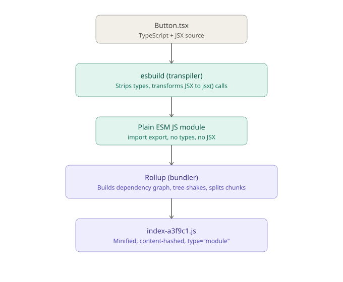
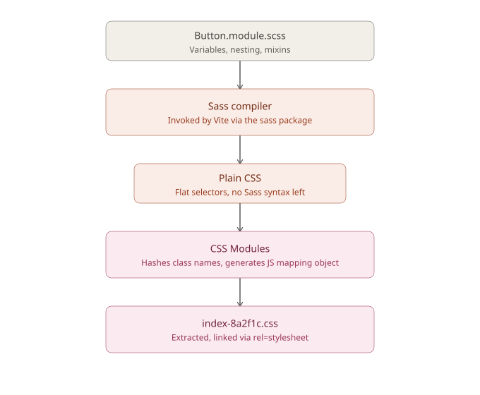
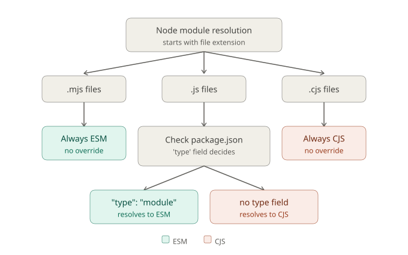

# JS/TS Module Extensions & Frontend Build Tooling Deep Dive
> **Session Date:** 2026-07-09
> **Duration context:** Deep-dive (multi-part technical exploration)
> **Tags:** `#jsx` `#tsx` `#esm` `#cjs` `#nodejs` `#vite` `#esbuild` `#rollup` `#packagejson` `#sass` `#css-modules` `#senior-interview-prep`

## Overview
This session untangles a set of file-extension and module-system concepts that frequently confuse frontend developers moving into senior-level interviews: `.jsx`/`.tsx`/`.ts`/`.js` (syntax extensions) versus `.mjs`/`.cjs` (module-system extensions), how Node resolves module format via `package.json`, the difference between `main`/`module`/`exports` fields, the actual build pipeline of a Vite + React + TypeScript app (esbuild vs Rollup, transpiler vs bundler), how SCSS gets compiled to CSS, and finally a full ESM vs CommonJS syntax and tradeoff comparison — including *why* CJS hasn't died despite ESM's technical advantages.

## Core Concepts

### Two independent axes: syntax vs module system
The central confusion the user had going in was treating `.jsx`/`.tsx` and `.mjs`/`.cjs` as points on the same spectrum. They are not — they answer two completely different questions:

- **Syntax extensions** (`.js`, `.jsx`, `.ts`, `.tsx`, `.d.ts`) tell the **transpiler/compiler** what parser and transform to apply to the file's *contents*. None of these are ever executed directly by a browser or Node — they're always transpiled down to plain `.js` first (via Babel, `tsc`, esbuild, or SWC). `.d.ts` files contain type declarations only and are erased entirely at compile time.
- **Module-system extensions** (`.mjs`, `.cjs`) tell the **Node runtime** which module resolution algorithm to use for that specific file — ESM or CommonJS — completely independent of whether the code inside uses JSX or TypeScript.

Key clarification: bundlers like Vite/webpack/esbuild use file extensions purely as **syntax/loader hints** when building a browser app — they don't apply Node's CJS-vs-ESM runtime semantics at all. Node's `.mjs`/`.cjs`/`"type"` rules only matter when **Node itself** executes the file directly (SSR entry points, Node scripts, config files like `next.config.mjs`).

### How `.js` gets its module system: the `package.json` `"type"` field
| Extension | Module system | Overridable? |
|---|---|---|
| `.mjs` | Always ESM | No — forced regardless of `package.json` |
| `.cjs` | Always CommonJS | No — forced regardless of `package.json` |
| `.js` | Depends on nearest `package.json`'s `"type"` field | `"type": "module"` → ESM; `"commonjs"` or absent → CJS (default) |

`.mjs`/`.cjs` exist specifically to let a project **mix both module systems** without fighting the `package.json` default — e.g. one ESM-only config file (`vite.config.mjs`) inside an otherwise CJS project, or vice versa.

Node's resolution order for a `.js` file with no explicit `"exports"` override:
1. Explicit extension (`.mjs`/`.cjs`) → module type forced, done.
2. `.js` file → walk up to nearest `package.json`, read `"type"`.
3. If the package has an `"exports"` field, that becomes the *only* thing consulted — it can bypass `"main"` entirely and define **conditional exports** (see below).

### CJS vs ESM — mechanical differences (not just syntax)

**1. Static vs dynamic loading**
```js
// CJS — require() is a function call, fully dynamic
if (condition) {
  const mod = require('./a'); // valid anywhere, any time
}

// ESM — import is a declaration, statically analyzed
if (condition) {
  import mod from './a'; // SyntaxError — must be top-level
}
```
This static analyzability is *why* tree-shaking works reliably with ESM and not CJS — bundlers can determine the full import graph without executing code. CJS's `require()` is opaque until runtime, so dead-code elimination has to guess or give up.

**2. Live bindings vs value copies**
```js
// counter.mjs
export let count = 0;
export function increment() { count++; }

// consumer.mjs
import { count, increment } from './counter.mjs';
increment();
console.log(count); // 1 — live binding, reflects the mutation
```
ESM named exports are **live, read-only views** into the exporting module's binding, not copies. CJS's `module.exports` gives a snapshot reference — reassigning a primitive inside the module won't propagate to consumers the same way. This is a classic interview trap.

**3. `this`, `__dirname`, top-level await**
- CJS: top-level `this` === `module.exports`; `__dirname`/`__filename` available natively.
- ESM: top-level `this` is `undefined`; no `__dirname` — reconstruct via `import.meta.url` + `fileURLToPath`. ESM uniquely supports **top-level `await`**, which CJS structurally cannot support since `require` is synchronous by design.

**4. The interop hazard**
```js
// Requiring a pure-ESM package from CJS: hard failure
const pkg = require('some-esm-only-pkg');
// ERR_REQUIRE_ESM — must use dynamic import() instead, which returns a Promise
```
Importing CJS from ESM generally works — the default export becomes `module.exports` as a whole, and named exports are reconstructed via static analysis (`cjs-module-lexer`) — but this can silently fail to detect exports set conditionally.

**Dual package hazard**: if a package is `require`'d in one part of the dependency tree and `import`'ed in another, Node may load *two separate instances* of it — breaking `instanceof` checks, singletons, and shared state (e.g. two copies of React breaking Context).

### Ecosystem reality: who ships what today
Neither `.mjs` nor CJS `.js` uniformly dominates. Three patterns coexist:

1. **Pure ESM packages** — `"type": "module"` in `package.json`, all `.js` files are ESM, no `.mjs` needed. Increasingly the default for new/actively-maintained packages, especially CLI/tooling packages (`chalk`, `execa`, `node-fetch` v3+, `nanoid`) that explicitly dropped CJS support ("ESM-only").
2. **Dual packages (CJS + ESM)** — big ecosystem-critical libraries (React, `date-fns`, AWS SDK) still ship both, using `.mjs`/`.cjs` extensions in their `dist/` output plus `"exports"` conditions to route consumers to the right one, because breaking `require()` consumers is a large compatibility cost.
3. **Legacy CJS-only** — still enormous in volume; unmaintained packages, older Express middleware, internal company code. No `"type"` field, defaults to CJS. Not going away — Node supports CJS indefinitely.

Node's own direction is toward ESM as the default (top-level await, JSON modules, and increasing `require(esm)` interop support), but widely-depended-upon libraries will keep shipping dual builds for a long time yet.

### `package.json`: `main` vs `module` vs `exports`

**`"main"`** — the original CJS-era entry point field. A single string, no conditions, read by Node and every bundler/tool as the universal fallback when nothing more specific is present. Says nothing about ESM vs CJS by itself — that's determined separately by `"type"`/extension.

**`"module"`** — **not a Node spec field at all.** A bundler-only convention invented by webpack/Rollup authors before Node had real ESM support, so a package could point `"main"` at CJS (Node-safe) while also exposing an ESM build via `"module"` for tree-shaking. Node's `require()`/`import` resolver ignores it completely; it survives today mainly for backward compatibility with older bundler configs.

**`"exports"`** — the modern, authoritative field (Node 12+). If present, it is the **only** thing consulted for resolving imports from that package — `"main"` and `"module"` are ignored entirely by anything that respects `"exports"`. It also **encapsulates** the package: only explicitly listed subpaths are importable.

```json
{
  "exports": {
    ".": {
      "import": "./dist/index.mjs",
      "require": "./dist/index.cjs",
      "types": "./dist/index.d.ts"
    }
  }
}
```
The resolver picks a branch based on how the consumer imports:

| Consumer does | Condition matched | File loaded |
|---|---|---|
| `import x from 'pkg'` | `"import"` | `./dist/index.mjs` |
| `require('pkg')` | `"require"` | `./dist/index.cjs` |
| TypeScript resolving types | `"types"` | `./dist/index.d.ts` |

Conditions can nest further (`"node"`, `"browser"`, `"default"`, checked top-to-bottom, first match wins) and support subpath exports (`"./utils"`) that restrict what's importable — `import x from 'pkg/internal/secret'` fails with `ERR_PACKAGE_PATH_NOT_EXPORTED` if not explicitly listed, even if the file physically exists.

**Resolution priority (Node and modern bundlers):**
1. `"exports"` exists → use it exclusively, ignore `"main"`/`"module"`.
2. No `"exports"` → check `"module"` if the bundler is configured to prefer it (e.g. Vite's default `resolve.mainFields: ['browser', 'module', 'main']` for client builds).
3. Still nothing → fall back to `"main"`.
4. Nothing at all → fall back to `index.js` by convention.

### Vocabulary: compiler vs transpiler vs bundler
| Term | What it actually does | Example |
|---|---|---|
| Compiler | Source language → different target, often with type-checking | `tsc` compiling TS → JS *with* type-checking |
| Transpiler | Source-to-source, roughly same abstraction level, no type-checking | esbuild, Babel — JSX → JS, ES2022 → ES2015 |
| Bundler | Many files + import graph → fewer output files | Rollup, webpack, esbuild (in bundle mode) |

esbuild is unusual in that it can act as **both** a transpiler (single-file transform) *and* a simple bundler, depending on how it's invoked — this is a common source of confusion since Vite uses it in the transpiler role during dev/pre-bundling but hands the full app-bundling job to Rollup for production builds.

### The Vite + React + TS build pipeline (dev mode)
1. **Type stripping + JSX transform (esbuild)** — Vite does *not* run the full TypeScript compiler (`tsc`) on every file. It uses esbuild (written in Go, ~10–100x faster) to strip type syntax and transform JSX into plain function calls. Critically, **esbuild does not type-check** — it just deletes type syntax syntactically. Type errors are caught separately, decoupled from bundling, usually via the editor or a `tsc --noEmit` step in CI.
   ```tsx
   // Button.tsx — authored
   interface Props { label: string }
   export function Button({ label }: Props) {
     return <button>{label}</button>;
   }
   ```
   ```js
   // what the browser receives (roughly), using React's automatic JSX runtime
   export function Button({ label }) {
     return jsx("button", { children: label });
   }
   ```
   The automatic JSX runtime (`react/jsx-runtime`) is why modern React files no longer need `import React from 'react'` at the top — the transform auto-injects it.

2. **Dev server — native ESM, no bundling** — Vite serves each module as a separate native ESM file over HTTP, transformed on-demand. The browser's own `import` resolution walks the module graph; Vite just intercepts and serves. This is why Vite dev startup is near-instant regardless of project size. `node_modules` dependencies get **pre-bundled** once via esbuild into single ESM chunks (cached in `node_modules/.vite`) to avoid firing hundreds of individual HTTP requests for multi-file packages.

3. **HMR** — Vite injects a WebSocket client; on save, only the changed file is re-transformed and pushed over the socket, and React's Fast Refresh plugin swaps the component in place, preserving state. This works specifically because ESM modules are individually addressable/replaceable — CJS's mutable, order-dependent execution model doesn't support this cleanly.

### The Vite production build pipeline
`vite build` switches to **Rollup** for the actual bundling (Rollup's tree-shaking/chunking is more mature than esbuild's), while esbuild still handles the initial per-file TS/JSX transform:
1. Each `.tsx`/`.ts` file → type-stripped + JSX-transformed (esbuild).
2. Rollup builds the full module dependency graph from `import` statements.
3. **Tree-shaking** — unused exports eliminated, possible only because ESM's static imports let Rollup *prove* something unused at build time.
4. **Code splitting** — dynamic `import()` calls become separate lazy-loaded chunk files (how route-based lazy loading works).
5. **Minification** — esbuild or Terser strips whitespace, shortens variable names.
6. **Asset hashing** — output files get content hashes (`index-a3f9c1.js`) for cache-busting.
7. Final `dist/` output: hashed `.js` files (still `type="module"` by default), plus a rewritten `index.html`.

### The SCSS pipeline — a completely separate track
When a `.tsx` file does `import './Button.module.scss'`:
1. Vite detects the `.scss` extension and routes it to the **Sass compiler** (via the `sass` npm package — Vite doesn't implement Sass itself).
2. Sass compiles SCSS syntax (`$variables`, nesting, `&`, mixins) down to plain CSS.
3. Because the filename has `.module.scss`, Vite additionally applies **CSS Modules** — every class name gets locally scoped/hashed (`.button` → `.Button_button__x7f2a`), and Vite generates a JS object mapping original class names to hashed ones. That's why `import styles from './Button.module.scss'` yields a JS object — you're importing the generated mapping, not the CSS directly.
4. **Dev**: CSS is injected via a `<style>` tag, JS-injected, so HMR can swap styles without a page reload.
5. **Production build**: CSS is extracted entirely out of JS bundles into a separate `.css` file, auto-linked via `<link rel="stylesheet">` in the built `index.html` — this matters because you don't want styles blocked on JS parsing/execution for first paint.

### Final browser load order (production)
```html
<link rel="stylesheet" href="/assets/index-8a2f1c.css">
<script type="module" src="/assets/index-b91e4a.js"></script>
```
The browser parses HTML, fetches and paints CSS early, then fetches the JS as native `type="module"`, then executes `ReactDOM.createRoot(...).render(<App />)` to mount the component tree.

## Worked Examples

### ESM syntax
```js
// exporting
export const add = (a, b) => a + b;
export default function Button() { }

// importing
import Button, { add } from './utils.js';
import * as utils from './utils.js';
```

### CJS syntax
```js
// exporting
module.exports.add = (a, b) => a + b;
module.exports = function Button() { };

// importing
const Button = require('./utils.js');
const { add } = require('./utils.js');
```

### Dual-format package.json (ships both CJS and ESM)
```json
{
  "type": "commonjs",
  "main": "./dist/index.cjs",
  "module": "./dist/index.mjs",
  "exports": {
    ".": {
      "import": "./dist/index.mjs",
      "require": "./dist/index.cjs"
    }
  }
}
```

### Conditional exports with environment branching
```json
{
  "exports": {
    ".": {
      "node": {
        "import": "./dist/node.mjs",
        "require": "./dist/node.cjs"
      },
      "browser": "./dist/browser.esm.js",
      "default": "./dist/index.js"
    }
  }
}
```

## Diagrams

### tsx → bundle.js pipeline


Shows the five-stage transform: `Button.tsx` source → esbuild strips types/transforms JSX → plain ESM JS module → Rollup builds the dependency graph, tree-shakes, and splits chunks → final minified, content-hashed `index-a3f9c1.js`. Key point: esbuild is a per-file transpiler; Rollup is the whole-graph bundler — they're different jobs split across two tools for speed + correctness.

### scss → css pipeline


Shows the parallel, independent track for styles: `Button.module.scss` → Sass compiler resolves variables/nesting into plain CSS → CSS Modules hashes class names and generates a JS mapping object → extracted into `index-8a2f1c.css`, linked via `<link rel="stylesheet">` in production.

### Node's mjs/cjs/js module resolution


The core insight this diagram encodes: `.mjs` and `.cjs` are self-describing and can never be overridden. `.js` is the ambiguous case — its module system is inherited from the nearest `package.json`'s `"type"` field, which might be several directories up the tree, so moving a `.js` file to a different folder can silently change its runtime module system.

## Comparisons & Tradeoffs

### ESM vs CommonJS
| Aspect | ESM (`import`/`export`) | CJS (`require`/`module.exports`) |
|---|---|---|
| Loading model | Static, analyzed at build time | Dynamic, resolved at runtime |
| Tree-shaking | Reliable — bundlers can prove unused code | Unreliable — `require()` is opaque until executed |
| Named exports | Live bindings (read-only view into source) | Value copies / snapshot references |
| Conditional loading | Not possible at top level; needs `await import()` (async) | Trivial — `require()` anywhere, synchronously |
| Top-level await | Supported | Not possible (require is synchronous by design) |
| Browser support | Native (`<script type="module">`) | None — needs a bundler |
| `this` at top level | `undefined` | `module.exports` |
| `__dirname`/`__filename` | Not available natively (use `import.meta.url`) | Available natively |
| Ecosystem status | Default for new/greenfield packages | Still shipped by legacy + widely-depended libraries for compat |

### Why CJS hasn't died despite ESM's technical advantages
1. **Conditional/lazy loading is genuinely harder in ESM** — `require()` inside an `if` block is trivial; ESM forces `await import()`, changing control flow to async.
2. **Backward compatibility debt** — millions of CJS-only, unmaintained npm packages; ripping out CJS support would break huge swaths of production Node apps.
3. **Tooling lag** — some environments (older Jest configs, certain serverless/bundler setups) historically had rocky ESM support, pushing authors toward CJS or dual builds for widest compatibility.
4. **Simpler synchronous mental model** — for small scripts/internal tooling where tree-shaking and browser-native loading don't matter, CJS requires less ceremony.

**Emerging pattern**: greenfield, browser-facing, performance-sensitive code (e.g. a Vite/React app) is essentially always ESM now. CJS persists at the edges — legacy packages, Node-only scripts needing dynamic requires, and libraries that haven't done a breaking migration yet.

## Key Takeaways
- **Syntax extensions (`jsx`/`tsx`/`ts`) and module-system extensions (`mjs`/`cjs`) are orthogonal concerns that happen to both live in the file extension** — one tells the compiler what to parse, the other tells the Node runtime which resolution algorithm to use.
- **`.mjs`/`.cjs` are self-describing; `.js` inherits its module system from the nearest `package.json`'s `"type"` field** — this can change silently if a file moves between directories.
- **esbuild strips types, it doesn't check them** — type safety in a Vite pipeline comes from a separate `tsc --noEmit` step (editor or CI), not from the bundler.
- **esbuild = fast per-file transpiler; Rollup = whole-graph bundler with better tree-shaking** — Vite uses both, each for what it's best at.
- **`"module"` in `package.json` is not part of the Node spec** — it's a bundler-only convention that predates the `"exports"` field; `"exports"`, when present, is authoritative and ignores `"main"`/`"module"` entirely.
- **ESM named exports are live bindings, not copies** — a classic interview trap when reasoning about mutated exported state.
- **Tree-shaking works because ESM imports are statically analyzable; CJS's `require()` is opaque until runtime**, which is the root mechanical reason CJS can't be tree-shaken reliably.
- **CJS survives not out of inertia alone but because it does some things (conditional loading, sync simplicity) that ESM structurally cannot do as easily.**

## Open Questions / Next Steps
- Deeper trace through Node's `"exports"` field resolution algorithm step by step.
- Mechanics of how `cjs-module-lexer` reconstructs named exports from CommonJS modules for ESM interop.
- How `browserslist`/`build.target` determines what JS syntax survives into Vite's output (downleveling to ES2015 vs shipping modern syntax as-is).
- How Rollup's tree-shaking algorithm actually proves a piece of code is unused, under the hood.

## References
- Tools/concepts discussed: Vite, esbuild, Rollup, Sass (`sass` npm package), CSS Modules, `tsc`, Babel, SWC, `cjs-module-lexer`, Node.js module resolution algorithm, `package.json` `exports`/`main`/`module` fields.
