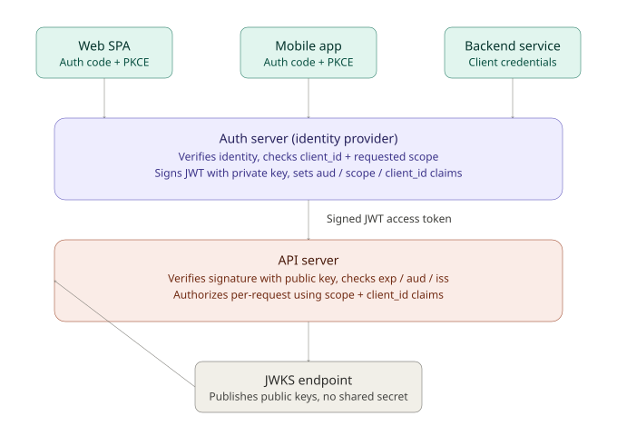
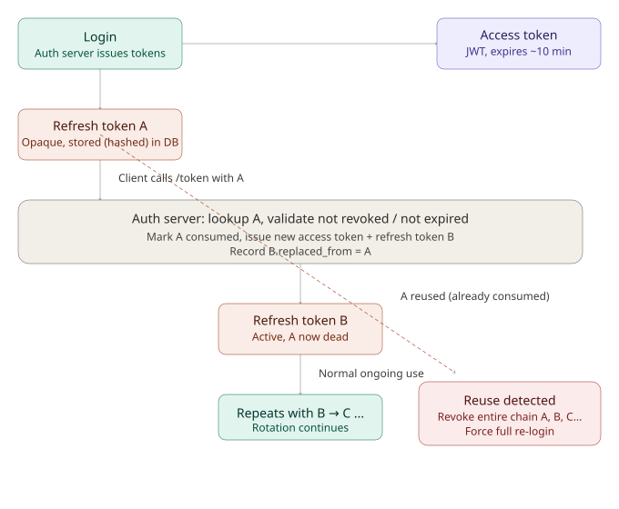

# JWT Auth Deep Dive: Logout, Multi-Client Issuance, Audience Boundaries, Token Leakage & JTI
> **Session Date:** 2026-07-06
> **Duration context:** Medium depth-first session, progressive Q&A
> **Tags:** `#jwt` `#oauth2` `#oidc` `#system-design` `#auth` `#jwks` `#token-revocation` `#refresh-tokens` `#token-rotation` `#interview-prep`

## Overview

This session works through JWT-based authentication from first principles up to real production hardening concerns, structured as a sequence of "but what about X" questions — the kind that come up in system design interviews and in real multi-service auth architecture. It starts with the classic "how do you logout with stateless JWTs" problem, moves into how to issue tokens correctly across multiple client types (web, mobile, service), then digs into the trust-boundary question of what actually stops one internal service from misusing another service's token, and ends with token leakage between teams and the role of the `jti` claim in surgical revocation.

## Core Concepts

### 1. Why "stateless" JWTs make logout hard

A JWT is self-contained — the server validates it purely via signature check, with no lookup required. That's the whole value proposition of "stateless." But it directly implies: **once issued, a valid JWT remains valid until `exp`, no matter what the server "wants" afterward.** There is no built-in hook to say "ignore this token now." Every real logout mechanism reintroduces *some* state — the design question is how much state, and where it lives.

**Approaches, from least to most stateful:**

1. **Short expiry, do nothing else** — 5–15 min `exp`, client deletes token locally. Token is still technically valid server-side until it expires. Fine for low-risk apps only.
2. **Refresh token split** — short-lived JWT access token (stateless) + long-lived opaque refresh token stored server-side (DB/Redis). Logout = delete the refresh token. Access token still works for its remaining minutes, but can't be renewed. Bounds the "damage window" to the access token's short lifetime while keeping most requests stateless.
3. **Blocklist / revocation list** — store revoked token IDs (`jti`) or per-user "revoked since" timestamps in Redis. Every request needs a lookup — you've traded away statelessness for instant revocability. Cheaper variant: store a `min_valid_iat` per user (one Redis key per user, not per token) and reject any token whose `iat` predates it.
4. **Token versioning** — a `token_version` column per user in the DB, embedded as a claim. Bump on logout; middleware compares JWT's version to DB version. Naturally supports "logout everywhere."

**What's typically used in practice:** combine #2 and #4 — short-lived JWT access tokens + revocable server-side refresh tokens, and reserve the version/blocklist check for privileged actions (password change, "logout all devices," admin-forced logout) rather than checking it on every single request, to avoid paying a DB hit per API call in the common case.

**Interview framing that matters more than naming all four mechanisms:**
> JWTs trade revocability for statelessness — you can't get instant logout without reintroducing a lookup somewhere. The engineering decision is where you put that lookup (per-request vs per-refresh) to balance security (revocation latency) against the scalability JWTs were meant to buy you.

---

### 2. JWT structure and mechanics

A JWT is three base64url-encoded parts joined by dots: `header.payload.signature`

- **Header** — algorithm + token type, e.g. `{"alg": "RS256", "typ": "JWT"}`
- **Payload** — claims. Standard ones: `sub` (subject/user id), `iss` (issuer), `aud` (audience — which API this token is for), `exp` (expiry), `iat` (issued at), plus custom claims (roles, scopes, tenant id, client_id).
- **Signature** — `sign(base64(header) + "." + base64(payload), key)`. This is the entire security model. The payload is only base64-encoded, not encrypted — anyone can read it. Only someone holding the signing key can produce a valid signature. Server's only job per request: recompute the signature and compare.

**Two signing modes:**

| Mode | Description | When to use |
|------|-------------|-------------|
| HMAC (HS256) | Symmetric — same secret signs and verifies | One service both issues and verifies (monolith) |
| RSA/ECDSA (RS256/ES256) | Asymmetric — auth server signs with private key, any number of services verify with public key | Multiple verifying services — never distribute a secret that could forge tokens |

---

### 2a. Refresh tokens — in depth

An access token proves "who you are and what you can do" for a short window. A refresh token proves something different: **"this client already went through a full login once — let it get a new access token without asking the user to log in again."** They're usually not even the same kind of artifact.

**Access token vs refresh token:**

| | Access token | Refresh token |
|---|---|---|
| Format | JWT (self-contained, signed) | Usually an **opaque random string** — not a JWT |
| Sent to | Every API call (`Authorization: Bearer`) | Only to the auth server's `/token` endpoint |
| Verified by | Any resource server, via signature + JWKS, no DB hit | Only the auth server, via a DB/store lookup |
| Lifetime | Minutes | Days to months |
| Contains claims? | Yes — `sub`, `scope`, `aud`, etc. | No — it's just a lookup key, meaningless on its own |

**Why opaque, not a JWT:** there's no requirement that a refresh token be self-contained. Most production systems deliberately make it a big random string with no embedded meaning, precisely *because* it needs to be revocable — a self-contained signed JWT is the wrong shape for something you want to be able to kill instantly.

**Who generates it, and where it lives:** the auth server generates it, at the same moment it issues the access token (right after login or a code exchange) — same "one issuer" principle as access tokens. It gets stored server-side, e.g.:

```
refresh_tokens
├── token_hash        (never store the raw token — hash it, like a password)
├── user_id
├── client_id
├── issued_at
├── expires_at
├── revoked  (boolean)
├── replaced_by  (for rotation chains)
└── device/session metadata (useful for "manage your sessions" UI)
```

Store a **hash** of the token, not the token itself — same reasoning as passwords. If the DB leaks, an attacker with raw refresh tokens could mint new access tokens indefinitely; with only hashes, they can't reconstruct the token from the hash.

This server-side row is the natural revocation point for logout: delete/mark-revoked this row, and the client can never get a new access token again — even though its current (short-lived) access token still works for a few more minutes.

**The refresh flow:**

1. Client holds an access token (expiring soon or expired) and a refresh token.
2. Client calls the auth server's token endpoint directly — not the API server:
   ```
   POST /oauth/token
   grant_type=refresh_token
   refresh_token=<the opaque string>
   client_id=<...>
   ```
3. Auth server hashes the incoming token, looks it up.
   - Not found / revoked / expired → reject, client must do a full login again.
   - Found and valid → issue a **new access token** (fresh JWT, fresh `exp`), and usually a **new refresh token too**, invalidating the old one.
4. Client swaps out both tokens and continues, transparently to the user — this is why access tokens can expire every 10 minutes without users noticing; the client refreshes silently in the background.

**Refresh token rotation — theft detection almost for free:** almost every serious implementation (Auth0, Entra ID, Okta) rotates refresh tokens — every use invalidates the token and issues a new one in its place, even if the old one hadn't expired yet.

- Legitimate client uses token A → gets token B back, A is now dead.
- If an attacker had *also* stolen token A and tries to use it later, the server sees "A" presented again after already being consumed → signal of reuse. Correct response: **revoke the entire token family** (B and anything issued after it), forcing a full re-login — the right tradeoff over silently letting a thief keep refreshing forever.
- The `replaced_by` chain field lets the server trace a token's lineage and nuke the whole family on detected reuse.

**Expiry:** refresh tokens expire too, but on a much longer scale — days to months. Two styles, often combined:
- **Absolute expiry** — hard ceiling regardless of use (e.g. 30 days from issuance).
- **Sliding/idle expiry** — expires if *not used* for N days, but pushes its own lifetime forward each time it's actually used. This is why daily-use apps seem to "never log you out," while rarely-opened apps ask for login again.

On the client side: when a refresh attempt is rejected (expired/revoked), the client discards both tokens and returns the user to login. There's no meaningful client-side expiry check for the refresh token the way there sort of is for access tokens — since it's opaque, the client can't inspect its own expiry; it just tries the refresh call and reacts to success/failure.

**Client-side storage (the weak point worth flagging):**
- **Web (browser)** — safest common pattern is an **HttpOnly, Secure, SameSite cookie**, so client-side JS (and therefore XSS) can never read it directly. Storing it in `localStorage` is a well-known anti-pattern for exactly this reason.
- **Mobile** — OS-level secure storage: Keychain (iOS), Keystore (Android). Never plain SharedPreferences/plist.
- **Backend/service (Client Credentials flow)** — often no refresh token exists at all; the service just re-requests a fresh access token directly with its client credentials when needed, since there's no "user session" to preserve.

A leaked refresh token is the scarier version of the earlier "accidentally shared token" scenario — it's long-lived and can keep minting new access tokens, whereas a leaked access token dies in minutes on its own.

**Closing the loop on Concept 1:** the honest answer to "how do you logout with stateless JWTs" is — you don't actually revoke the JWT itself; you revoke the refresh token that would have renewed it, and let the current JWT bleed out on its own short clock.

### 3. Multi-client token issuance

**Key design principle:** one identity provider/auth server, many clients, each client gets tokens scoped to what it needs — not a separate token system per client type.

Three separate concerns:
1. **Who is the user** (authentication) — same for every client
2. **Which client app is asking** (`client_id`, `azp`/`aud`)
3. **What can this specific token do** (`scope`)

**Per-client-type setup** (mirrors the MSAL/Entra ID app registration model):

- Each client type registers with the auth server → distinct `client_id`
- Each gets a grant type suited to its trust level:
  - **Web SPA** → Authorization Code + PKCE (no client secret, JS can't keep secrets)
  - **Mobile app** → same, Auth Code + PKCE
  - **Trusted first-party backend** → Client Credentials (service-to-service, no user)
  - **Third-party partner** → Auth Code, tighter scopes, possibly separate consent
- Resulting JWT carries `client_id`/`azp` + `scope` reflecting origin. The API verifies signatures the same way regardless of client, then makes authorization decisions off the claims.
- Access tokens stay short-lived (5–15 min) across all client types. What differs is the **refresh token policy**:
  - Mobile → long-lived refresh token in secure device storage (less login friction)
  - Web SPA → shorter refresh windows / silent-refresh via iframe
  - Client Credentials flow → often no refresh token at all — just re-request when expired, no "user session" concept

**Same access token format + verification everywhere. Different issuance path + scope granted per client.**

---

### 4. Verification mechanics — how the server checks a token

Every incoming request carries `Authorization: Bearer <token>`. Verification happens with no DB round-trip:

1. Split into header/payload/signature.
2. Look up the verification key. With RS256: fetch the auth server's public key from a **JWKS endpoint** (`/.well-known/jwks.json`). The token header carries a `kid` (key id) so the server knows exactly which public key to use. This is what enables key rotation — auth server signs with a new key while the old public key stays published for a grace period.
3. Recompute the signature using that public key, compare. Mismatch → reject, regardless of what the claims say.
4. Check claims: `exp` (not expired), `nbf` (not-before, if present), `iss` (trusted issuer), `aud` (token was actually issued *for this specific API* — critical once multiple APIs share one auth server).
5. Only then read `scope`/`client_id`/`sub` to decide authorization.

JWKS is fetched once and cached via normal HTTP caching — not hit per request. So steady-state verification is pure CPU (signature check), preserving the "stateless" property.

**Practical note (Entra ID):** this is exactly what `/.well-known/openid-configuration` → JWKS URI does under the hood. `aud` mismatches are a common bug source — a token minted for Microsoft Graph won't validate against your own API's expected audience.

---

### 5. What actually stops internal misuse across services sharing one auth server

**The key realization:** JWKS being widely reachable inside the org is *intentional*, not a flaw — public keys aren't secrets. Anyone who can verify a signature can confirm "the auth server really issued this," but that says nothing about who the token was meant for.

**The real trust boundary is `aud` (audience) enforcement, on the resource-server side:**

- Every API/resource server registers as its own **audience** with the auth server (in Entra ID: the App ID URI of the API's app registration, e.g. `api://orders-api`).
- Clients request tokens scoped to a *specific resource* (`api://orders-api/.default`), not a generic token. This is the OAuth "resource indicators" concept (RFC 8707).
- **Every resource server must check `aud === its-own-identifier` on every request and reject anything else** — even if the signature is perfectly valid and both services trust the same auth server.

**The realistic failure mode:** a team writes JWT middleware that checks signature + expiry but forgets to check `aud`. This is an implementation gap, not a flaw in JWTs.

**How mature orgs close this gap at scale:**
- Enforce `aud`/`scope` validation at the **gateway/service-mesh layer** (e.g. Istio `RequestAuthentication` + `AuthorizationPolicy`, or an Envoy JWT filter) — rejects mismatched-audience tokens *before* the request reaches service handler code, so individual engineers can't accidentally skip the check.
- One audience per logical API, not per deployment/instance — keeps the check a simple binary comparison.
- Narrow scopes per resource, requested explicitly.

**Going further — sender-constrained tokens** (for when even a correctly-`aud`-scoped bearer token being replayed is a concern):
- **DPoP (RFC 9449)** — client proves possession of a private key on every request via a signed proof header; token is cryptographically bound to that key.
- **mTLS-bound tokens (RFC 8705)** — token bound to the TLS client certificate used to obtain it.

Both convert the model from "whoever holds the token can use it" to "whoever holds the token *and* the matching key/cert can use it."

---

### 6. Same server issuing and verifying vs separate issuer/verifier — the spectrum

**Pattern 1 — Same server does both (monolith style):** one backend's `/login` signs a JWT with a secret it holds, and the same backend verifies later requests using that same secret. Usually HMAC (HS256), since there's no need for public/private separation with a single verifier. Fine for a single-service app. Breaks down the moment a second API needs to trust the tokens too — sharing the HMAC secret means every holder can *also forge* tokens, not just verify them.

**Pattern 2 — Separate auth server, multiple resource servers (the standard once you have >1 service):** a dedicated identity provider (self-built, Keycloak, Auth0, Entra ID) is the *only* thing that ever signs tokens (holds the private key). Every API server is a resource server that only ever verifies, using the public key from JWKS. Resource servers can't forge tokens even if compromised — they never hold the private key.

**Core principle:** signing capability should exist in exactly one place. Once two services can both *produce* valid tokens, "this token could only have come from a legitimate login" stops being a meaningful guarantee.

**Entra ID mapping:** the Entra tenant is the auth server. APIs register as resources ("expose an API" → App ID URI). Clients (SPA/mobile/service) register separately. None of your API servers ever hold Microsoft's signing key — they fetch the public JWKS and verify only.

---

### 7. Token leakage between teams / networks — bearer token risk

**Scenario discussed:** a dev accidentally shares a still-valid (60 min) token issued for one client with another team, on a different network segment within the same org.

**Blunt reality:** by default, nothing stops it. A JWT is a **bearer credential** — possession is the only proof required, and the token carries zero information about *where* it's allowed to be used from.

Walking through the checks the other team's call would hit:
- Signature check → passes (genuinely valid token)
- `exp` check → passes (still within window)
- `aud`/`scope` check → **passes too**, if calling the same API the token was meant for. This is the crucial insight: `aud` protects against *cross-API* misuse, not against the *right* API being called by the *wrong caller*. The leak isn't a "wrong audience" problem, it's a "wrong hands" problem.
- Request succeeds — indistinguishable from the legitimate client calling it.

**What actually mitigates this:**

1. **Network-level restriction** — VPC CIDR ACLs, private endpoints, security groups. Orthogonal to JWT validation; plain network segmentation. Worth auditing whether APIs are properly segmented per consumer.
2. **Sender-constrained tokens** — the direct fix. mTLS-bound tokens or DPoP bind the token to a specific TLS cert or private key held only by the original client; the other team's different service identity fails the binding check even holding a perfectly valid token.
3. **IP pinning in the token** (weaker) — embed issuing client's IP as a custom claim, check on each request. Brittle with NATs/load balancers/mobile IP changes — partial mitigation only.
4. **Detection over prevention** — log `client_id` + source IP/subnet per token use; flag or auto-revoke if the same token suddenly appears from an unexpected network/service identity mid-lifetime. This is where `jti`-based revocation (see below) becomes the actual lever you pull.

**Honest framing:** for a short 60-min token and an accidental internal share, it'll just work silently unless mTLS/DPoP or active anomaly monitoring is in place. This is a strong argument for keeping access token lifetimes very short (5–15 min, not 60) — it bounds the exploitable window even without sender-constraining.

---

### 8. `jti` (JWT ID) claim — in detail

`jti` is a **standard registered claim** (RFC 7519 — the JWT spec itself). Its job: give a single token instance a unique identifier, distinguishing it from every other token ever issued — even ones for the same user with otherwise identical claims.

**Example:**
```json
{
  "sub": "user_123",
  "aud": "api://orders-api",
  "iat": 1720240000,
  "exp": 1720240900,
  "jti": "b3f8c1a0-6e2d-4c9a-9f21-8d4e7a1b9c3e"
}
```

Typically a UUID v4 or cryptographically random string — long enough to avoid collisions, unguessable so it can't be forged to impersonate a specific token's identity.

**Why it's needed:** two tokens for the same user/client, issued a second apart, are otherwise nearly identical — same `sub`, `aud`, `scope`. Only `iat`/`exp` and `jti` differ. Without `jti`, there's no clean handle to refer to "this specific token" as opposed to "this user" or "this session" — you'd have to hash the whole token or use timestamps as a fuzzy identifier.

**Primary use — connects directly to logout/revocation (Concept 1):**
- On logout, or on detecting suspicious use (e.g. the leaked-token scenario), store that token's `jti` in a revocation store (Redis), with a TTL matching the token's remaining `exp` so entries auto-expire.
- On every request, after signature/`exp`/`aud` checks pass: **is this `jti` in the blocklist?** If yes, reject even though otherwise valid.
- Contrast with the coarser "min valid `iat` per user" approach: that revokes *all* tokens for a user at once. `jti`-based revocation is **surgical** — kill one specific token (e.g. the one accidentally shared with another team) without touching the user's other valid sessions.

**Other uses:**
- **Replay-attack prevention** — for single-use tokens/assertions (DPoP proofs, SAML-style grants), record seen `jti`s and reject repeats.
- **Audit/traceability** — log `jti` alongside `sub` and `client_id` for precise incident response — know exactly which token was misused, not just which user.
- **Idempotency-adjacent tracking** — occasionally used as a dedup key when a token also functions as a single-use action authorization.

**The tradeoff:** checking `jti` against a blocklist per request reintroduces a lookup — same statelessness-vs-revocability tension as the whole logout discussion. Common compromise: only blocklist-check tokens flagged sensitive/high-scope, or accept it because a Redis `EXISTS` call is sub-millisecond relative to the value gained — surgical, immediate kill of one compromised token.

## Diagrams

### Multi-client JWT issuance and verification flow


Shows three client types (web SPA, mobile app, backend service) each authenticating via a different OAuth2 grant type suited to their trust level, all against one auth server that holds the sole signing key. The auth server issues signed JWTs with `aud`/`scope`/`client_id` claims. A single API server verifies every token the same way — checking the signature against a public key fetched from the JWKS endpoint — regardless of which client type it came from. This illustrates the "one issuer, many verifiers" principle and where `client_id`/`scope` differentiation actually lives (in issuance, not verification logic).

### Refresh token rotation and theft detection lifecycle


Shows the full lifecycle: login issues an access token plus refresh token A (stored hashed at the auth server). The client later presents A to `/token` to get a new access token plus a new refresh token B, which invalidates A. Normal use continues the chain (B → C → ...). The dashed red branch shows the theft-detection path: if A is ever presented again after already being consumed, the auth server treats this as a reuse signal and revokes the entire token family, forcing a full re-login rather than silently trusting the request.

## Comparisons & Tradeoffs

### Access token vs refresh token

| Aspect | Access token | Refresh token |
|---|---|---|
| Format | JWT (self-contained, signed) | Opaque random string |
| Sent to | Every API call | Only the auth server's `/token` endpoint |
| Verified by | Any resource server, via JWKS, no DB hit | Only the auth server, via DB/store lookup |
| Lifetime | Minutes | Days to months |
| Stored server-side? | No | Yes (hashed, like a password) |
| Revocation | Not directly possible before `exp` (needs blocklist/jti) | Directly — delete/mark the stored row |

### Logout / revocation mechanisms

| Approach | Statelessness preserved? | Revocation latency | Granularity |
|---|---|---|---|
| Short expiry only | Full | Up to `exp` (minutes) | N/A — no active revocation |
| Refresh token split | Mostly (per-refresh lookup only) | Bounded by access token lifetime | Per refresh token (≈ per session) |
| Blocklist (`jti` or `min_valid_iat`) | No (per-request lookup) | Immediate | `jti` = per-token (surgical); `min_valid_iat` = per-user (blunt) |
| Token versioning | No (per-request lookup) | Immediate | Per-user, all sessions at once |

### HMAC vs RSA/ECDSA signing

| Aspect | HMAC (HS256) | RSA/ECDSA (RS256/ES256) |
|---|---|---|
| Key type | Symmetric (one shared secret) | Asymmetric (private signs, public verifies) |
| Who can verify | Anyone with the secret — and anyone with it can also forge | Anyone with the public key — can verify only, cannot forge |
| Best fit | Single service issues and verifies (monolith) | Auth server issues, multiple resource servers verify |

### Same-server vs separate auth server

| Aspect | Same server issues + verifies | Separate auth server (IdP) + resource servers |
|---|---|---|
| Signing key exposure | Every service holding it can forge tokens | Only the IdP ever holds the private key |
| Scales to multiple APIs | Poorly — secret sharing needed | Naturally — public key distribution only |
| Typical signing mode | HMAC | RSA/ECDSA |
| Real-world example | Small monolith's own `/login` | Entra ID tenant + App registrations as resource servers |

## Key Takeaways

- **JWTs trade revocability for statelessness** — you cannot get instant logout without reintroducing a lookup somewhere; the design decision is *where* that lookup lives (per-request vs per-refresh vs privileged-action-only).
- **`aud` enforcement is the actual internal trust boundary**, not JWKS access control — JWKS being widely readable is intentional (public keys aren't secrets); the resource server rejecting mismatched `aud` is what prevents cross-service token misuse.
- **`aud` checks protect against wrong-API use, not wrong-caller use.** A leaked token used from a different network/team against the *correct* API will pass every standard check (signature, `exp`, `aud`, `scope`) — bearer tokens carry no notion of "where" they're allowed to be used from.
- **Signing capability should exist in exactly one place.** The moment more than one service can produce valid tokens, "this could only have come from a legitimate login" stops being a real guarantee — this is why separate auth-server/resource-server architecture (RS256 + JWKS) is standard once you're past a single monolith.
- **Sender-constrained tokens (DPoP, mTLS-bound) are the actual fix for bearer-token replay/leakage** — they convert "whoever holds the token can use it" into "whoever holds the token *and* the matching key/cert can use it."
- **`jti` enables surgical, per-token revocation** — distinct from the coarser per-user `min_valid_iat` or token-versioning approaches, which revoke everything for a user at once.
- **Short access token lifetimes (5–15 min) are a cheap, high-value mitigation** for accidental leaks even without sender-constrained tokens — they simply bound the exploitable window.
- **Interview-ready framing:** "JWTs trade revocability for statelessness — the engineering decision is where you put the lookup to balance revocation latency against the scalability JWTs were meant to buy you."
- **Refresh tokens should be opaque, not JWTs** — they need to be revocable by direct DB lookup, which is the opposite design goal of a self-contained signed token.
- **Refresh token rotation converts an unanswerable question ("was my refresh token stolen?") into a detectable one** — reuse of an already-consumed token is a clear signal, and the correct response is revoking the whole token family, not just the one reused token.
- **The real logout mechanism, precisely stated:** you don't revoke the JWT — you revoke the refresh token that would have renewed it, and let the current access token expire on its own short clock.

## Open Questions / Next Steps

- Deeper dive on **DPoP (RFC 9449)** mechanics — proof header structure, replay window, how clients generate and rotate the bound key.
- Deeper dive on **mTLS-bound tokens (RFC 8705)** — cert-to-token binding (`cnf` claim, `x5t#S256`) and operational overhead of managing client certs at scale.
- How **Istio `RequestAuthentication` + `AuthorizationPolicy`** concretely enforces `aud`/`scope` checks at the sidecar level — worth connecting to prior Entra ID/MSAL/OIDC/Istio-Envoy sidecar work.
- JWKS key rotation mechanics in more depth (grace periods, `kid` rollover strategy).
- Anomaly-detection approaches for token misuse (logging `client_id` + source IP/subnet per use, auto-revoke triggers) as a practical alternative to full sender-constraining.

## References

- RFC 7519 — JSON Web Token (JWT), defines `jti` and other standard claims
- RFC 8707 — Resource Indicators for OAuth 2.0 (the `aud`-scoping mechanism)
- RFC 9449 — DPoP (Demonstrating Proof-of-Possession)
- RFC 8705 — OAuth 2.0 Mutual-TLS Client Authentication and Certificate-Bound Access Tokens
- Microsoft Entra ID / MSAL — App registrations as resource servers, `/.well-known/openid-configuration` and JWKS URI
- Istio `RequestAuthentication` and `AuthorizationPolicy` — gateway/mesh-level JWT enforcement
